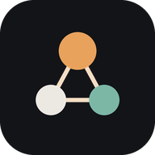

# Crew

**Ett självhostat team av alltid-på AI-kollegor som delar en riktig dator.**

Crew är inspirerat av xAI:s Grok Bot men byggt för att köras hemma hos dig – på en VPS eller din NAS. Du skapar namngivna botar ("Vera – chief of staff", "Nils – research", "Siri – inkorg") och skriver till dem som till kollegor, en och en eller i gruppchatt. De jobbar i bakgrunden på en gemensam Linux-dator med riktig webbläsare, filer och terminal – även när du stänger appen – och hör av sig när något behöver ditt godkännande.

<p align="center"></p>

## Innehåll

- [Funktioner](#funktioner)
- [Snabbstart](#snabbstart)
- [Konfiguration (.env)](#konfiguration-env)
- [Köra på en VPS](#köra-på-en-vps)
- [Köra på en NAS](#köra-på-en-nas)
- [Så använder du Crew](#så-använder-du-crew)
- [Säkerhet](#säkerhet)
- [Arkitektur](#arkitektur)
- [Utveckling](#utveckling)
- [Felsökning](#felsökning)
- [Begränsningar & idéer framåt](#begränsningar--idéer-framåt)

## Funktioner

| | |
|---|---|
| **Team av botar** | Namn, avatar, roll, instruktioner och **valfri modell per bot**. En bot kan vara teamledare och fördela arbete. |
| **Delad dator** | En Docker-container med Chromium (persistent profil → inloggningar sparas), filsystem och terminal. Alla botar delar dator, men varje bot får en egen flik så de inte krockar. |
| **Bakgrundsjobb** | Körningar ligger i en jobbkö (Redis/BullMQ) och sparas steg för steg i Postgres. Stäng appen, starta om servern – jobbet fortsätter. |
| **Direkt- & gruppchatt** | @-nämn botar för att väcka dem. Botar kan lämna över uppgifter till varandra (`delegate`) och svara varandra i samma tråd. |
| **Live-vy** | Se varje steg (med skärmdumpar) och en **livebild av botens webbläsare** (noVNC) direkt i appen. |
| **Godkännanden** | Riskabla åtgärder (skicka, posta, köpa, radera, logga in, ändra konton, riskabla terminalkommandon, nya routines, skrivande MCP-verktyg) pausar och ber om lov: **Tillåt en gång / Neka / Tillåt alltid** (per bot och åtgärdstyp). Valfri oberoende "auto review"-modell. |
| **Secure handoff** | Vid lösenord, 2FA, BankID eller CAPTCHA tar du över webbläsaren i appen och lämnar tillbaka. Botarna kan inte skriva i lösenordsfält. |
| **Minne du kan se** | Per bot + delat minne som **vanliga Markdown-filer**. Läs, redigera, radera – och ångra varje ändring. Ändringar syns i chatten. |
| **Skills** | Lyckade arbetsflöden sparas som återanvändbara skills (Markdown). |
| **Routines** | Schemalagda jobb (cron, valfri tidszon) och **webhooks**, med körhistorik. Botar kan själva skapa routines (kräver godkännande). |
| **Modellagnostiskt** | Anthropic (Claude), xAI (Grok, OpenAI-kompatibelt) och valfri annan OpenAI-kompatibel endpoint (Ollama, OpenRouter, LM Studio, vLLM …). Byt modell per bot eller per chatt direkt i inmatningsfältet. Ett offline-**demoläge** gör att allt kan testas utan nycklar. |
| **MCP** | Koppla MCP-servrar (fjärr via HTTP, eller lokala via stdio som körs isolerat på botarnas dator). Flera konton av samma typ går bra. |
| **Åtgärdslogg** | Varje åtgärd loggas med maskerade hemligheter. |
| **PWA + push** | Installera som app på mobil och dator. Pushnotiser när en bot behöver dig eller är klar. |
| **Röst** | Diktering i inmatningsfältet och ett handsfree-röstläge (lyssna → boten jobbar → läser upp svaret). Röst per bot. Använder webbläsarens inbyggda tal – inga extra nycklar. |
| **Inloggning** | Lösenord (argon2) + **passkeys**. Skydd mot brute force. |

### Vad Crew gör bättre än originalet

- **Självhostat** – din data, dina nycklar, din hårdvara.
- **Inte låst till en modell** – välj modell per bot (och per chatt).
- **Du ser vad botarna minns** – minnet är filer du kan läsa, ändra och ångra. Minnesändringar loggas och visas i chatten (Grok Bot granskar inte minnesskrivningar).
- **Valbar isolering** – MCP-verktyg kan begränsas till vissa botar, och varje bot har en egen webbläsarflik.

## Snabbstart

Krav: Docker med Compose v2, ~4 GB RAM, ~8 GB disk.

```bash
git clone https://github.com/elurhguth/eliaspython.git crew && cd crew
git checkout crew        # grenen där Crew ligger
cp .env.example .env
# Fyll i minst: POSTGRES_PASSWORD, WORKSTATION_TOKEN (openssl rand -hex 32)
# och en modellnyckel: ANTHROPIC_API_KEY och/eller XAI_API_KEY
docker compose up -d --build
```

Öppna <http://localhost:8080>. Första gången skapar du ditt konto i webbläsaren (eller sätt `ADMIN_PASSWORD` i `.env`). Ett startteam med tre botar skapas automatiskt – ändra dem fritt.

> Utan modellnyckel körs botarna i **demoläge**: ingen AI, men du kan testa datorn, godkännanden, handoff, minne och routines med kommandon som *"öppna example.com och ta en skärmdump"*, *"kör uname -a"*, *"kom ihåg att jag dricker te"*, *"skicka mejlet på example.com"* eller *"logga in på example.com"*.

Lägger du till en API-nyckel senare (`docker compose up -d` efter ändringen i `.env`) flyttas startteamet automatiskt från demo till den riktiga modellen – så länge du inte själv har ändrat någon bots modell.

Uppdatera senare: `git pull && docker compose up -d --build`.

## Konfiguration (.env)

Se [`.env.example`](.env.example) för alla variabler. De viktigaste:

| Variabel | Beskrivning |
|---|---|
| `PUBLIC_URL` | Adressen du öppnar Crew på, t.ex. `https://crew.example.com`. Används för passkeys och säkra cookies. |
| `CREW_SITE_ADDRESS` | `:80` för vanlig HTTP. Sätt ett domännamn för automatisk HTTPS (Let's Encrypt) via Caddy. |
| `HTTP_PORT` / `HTTPS_PORT` | Portar på värden (standard 8080/8443). |
| `POSTGRES_PASSWORD`, `WORKSTATION_TOKEN` | **Krävs.** Långa slumpsträngar. |
| `ANTHROPIC_API_KEY`, `ANTHROPIC_DEFAULT_MODEL` | Claude. Standardmodell `claude-opus-5-5`. |
| `ANTHROPIC_REFUSAL_FALLBACK` | Server-side fallback om en Claude Opus 5.x/Fable/Sonnet 5.5-modell avböjer (standard på). |
| `XAI_API_KEY`, `XAI_BASE_URL`, `XAI_DEFAULT_MODEL` | Grok via `https://api.x.ai/v1`. |
| `OPENAI_COMPAT_*` | Valfri annan OpenAI-kompatibel endpoint, t.ex. Ollama `http://192.168.1.10:11434/v1`. |
| `AUTO_REVIEW_MODEL` | Valfri oberoende granskare av riskabla åtgärder, t.ex. `anthropic:claude-haiku-5-5`. |
| `BRAVE_API_KEY` | Använd Brave Search i stället för den inbyggda SearXNG. |
| `MAX_STEPS_PER_RUN`, `WORKER_CONCURRENCY`, `MAX_BOT_CHAIN_DEPTH` | Gränser för körningar. |
| `TZ`, `BROWSER_LANG` | Tidszon och webbläsarspråk på datorn. |

Modellistan i appen hämtas live från varje leverantör, så nya modeller dyker upp automatiskt. Du kan också skriva in valfri modell som `provider:modell`.

## Köra på en VPS

1. Skaffa en VPS (minst 2 vCPU / 4 GB RAM; 8 GB om flera botar surfar samtidigt) och peka en DNS-post (t.ex. `crew.example.com`) mot den.
2. Installera Docker: `curl -fsSL https://get.docker.com | sh`
3. I `.env`:
   ```env
   PUBLIC_URL=https://crew.example.com
   CREW_SITE_ADDRESS=crew.example.com
   HTTP_PORT=80
   HTTPS_PORT=443
   ```
4. `docker compose up -d --build` – Caddy hämtar ett certifikat automatiskt.
5. Öppna bara port 80/443 i brandväggen (t.ex. `ufw allow 80,443/tcp`). Databas, Redis och datorn exponeras aldrig utåt.

## Köra på en NAS

Crew fungerar på NAS:ar som kör Docker (Synology DSM 7.2+ "Container Manager", QNAP Container Station, Unraid, TrueNAS SCALE, OpenMediaVault). Både **x86-64 och ARM64** stöds (Playwright-imagen finns för båda).

- **Synology:** Container Manager → Projekt → Skapa → välj mappen med Crew (där `docker-compose.yml` ligger) → bygg. Eller via SSH: `sudo docker compose up -d --build`.
- **Portar:** NAS:en använder ofta 80/443 själv. Behåll `HTTP_PORT=8080` och nå Crew på `http://nas-ip:8080`, eller lägg NAS:ens egen reverse proxy framför (vidarebefordra **WebSocket** och stäng av buffring för `/api/events`).
- **HTTPS utan att öppna porten:** enklast är [Tailscale](https://tailscale.com) – kör `tailscale serve --bg 8080` på NAS:en och använd `https://nas.tailnet-namn.ts.net` som `PUBLIC_URL`. HTTPS krävs för passkeys, pushnotiser och PWA-installation på iPhone.
- **Resurser:** räkna med ~1,5 GB RAM i vila (Chromium + Postgres + Redis + SearXNG). Svaga ARM-NAS:ar fungerar men webbläsaren blir långsammare.
- **Bakom företagsproxy med egen CA?** Lägg CA-certifikatet (`*.crt`) i `certs/` innan du bygger. Imagerna litar då på det (npm, apt, Node och Chromium). Behöver du byta Ubuntu-spegel: `docker compose build --build-arg UBUNTU_MIRROR=https://se.archive.ubuntu.com`.

### Backup

All data ligger i Docker-volymer:

| Volym | Innehåll |
|---|---|
| `crew_postgres-data` | Botar, chattar, körningar, regler, logg |
| `crew_crew-data` | Minne (`memory/`), skills, skärmdumpar, uppladdade bilder |
| `crew_workstation-home` | Botarnas dator: filer, webbläsarprofil med inloggningar |
| `crew_redis-data` | Jobbkö och scheman |

Exempel: `docker run --rm -v crew_crew-data:/d -v $PWD:/b alpine tar czf /b/crew-data.tgz -C /d .`
Databasen: `docker compose exec postgres pg_dump -U crew crew > crew.sql`

## Så använder du Crew

- **Ny uppgift:** välj en eller flera botar på startsidan och skriv. Flera botar = gruppchatt.
- **@-nämn** en bot för att rikta dig till den (`@nils kan du kolla priserna?`). Utan @ svarar teamledaren i grupper.
- **Datorn** (knappen uppe till höger i en chatt): *Live* visar webbläsaren i realtid, *Steg* visar varje åtgärd med skärmdumpar, *Filer* låter dig bläddra och ladda ned det botarna skapat.
- **Ta över:** när en bot ber om det (eller när du själv vill) klickar du *Ta över datorn*, loggar in, och trycker *Klar – lämna tillbaka*.
- **Godkännanden:** kort dyker upp i chatten och under *Godkännanden* (med notis). *Tillåt alltid* skapar en regel som du kan ändra i botens inställningar.
- **Stoppa:** fyrkant-knappen i inmatningsfältet avbryter pågående körningar. Du kan också skriva nya instruktioner medan en bot jobbar – den läser dem.
- **Modell:** byt i inmatningsfältet (gäller den chatten) eller i botens inställningar (standard för boten).
- **Minne & skills:** se och ändra allt som botarna sparat. Varje ändring kan ångras.
- **Routines:** "Varje vardag 07:30: gå igenom min inkorg…". *Webhook*-knappen ger en hemlig URL – POST:a JSON till den så startar routinen med datan.
- **MCP:** Inställningar → Källor & verktyg. Exempel på lokal server: kommando `npx`, argument `-y @modelcontextprotocol/server-github`, miljövariabel `GITHUB_PERSONAL_ACCESS_TOKEN=…`.
- **Röst:** mikrofonen dikterar. Vågform-ikonen startar röstläget (handsfree). Välj röst per bot i botens inställningar.
- **Installera som app:** Safari → Dela → Lägg till på hemskärmen (iOS), eller installera-ikonen i Chrome/Edge. Slå på notiser under Inställningar.

## Säkerhet

Läs det här innan du ger botarna tillgång till dina konton.

- **Isolering:** botarnas dator (`workstation`) kör som en oprivilegierad användare och ligger **inte** på samma Docker-nätverk som Postgres och Redis. Den nås bara med en hemlig token.
- **Livevyn/övertagandet** (`/vnc/`) är skyddat av inloggningen (Caddy `forward_auth`).
- **Lösenord och 2FA** skrivs aldrig av botarna: fält av typen lösenord eller engångskod vägras och boten måste be om handoff.
- **Hemligheter** (API-nycklar, tokens, lösenordsliknande fält) maskeras i loggar, händelser och verktygsutdata. API-nycklar finns bara på servern och skickas aldrig till webbläsaren eller modellen.
- **Godkännanden** är en spärr, inte en garanti. Klassningen bygger på botens angivna avsikt plus nyckelord (och valfritt en granskningsmodell). Ge inte *Tillåt alltid* för köp eller radering.
- **Prompt injection:** webbsidor och mejl kan innehålla instruktioner riktade till AI:n. Därför finns godkännanden för utåtriktade åtgärder. Ge botarna konton med minsta möjliga behörighet. Serververktyget `web_fetch` blockerar interna adresser (SSRF-skydd). Kör du på en molnleverantör med metadata-tjänst (169.254.169.254) bör du blockera den från Docker-nätverket i brandväggen.
- **Delad dator = delade inloggningar.** Alla botar ser samma webbläsarprofil (precis som i Grok Bot). Använd MCP-begränsningar per bot för känsliga verktyg.
- **Uppdatera** regelbundet (`git pull && docker compose up -d --build`) för säkerhetsfixar i Chromium.

## Arkitektur

```
           Webbläsare / PWA (mobil & dator)
                        │ HTTPS
                ┌───────▼────────┐
                │  web (Caddy)   │  statisk Next.js-app, TLS
                └──┬──────────┬──┘
          /api/*   │          │  /vnc/* (kräver inloggning)
         ┌─────────▼───┐   ┌──▼────────────────────────────┐
         │ server      │   │ workstation  ("datorn")       │
         │ Fastify API │   │ Chromium (CDP) · Xvfb · noVNC │
         │ SSE · auth  │   │ toold: browser/shell/filer/   │
         └──┬───────┬──┘   │ stdio-MCP · /home/crew        │
            │       │      └──▲────────────────────────────┘
     ┌──────▼─┐  ┌──▼────┐    │ token-skyddat HTTP
     │Postgres│  │ Redis │◄───┼───────────┐
     └────────┘  └───────┘    │           │
         ▲  (internt nät)  ┌──┴──────────┐│
         └─────────────────┤ worker      ├┘ BullMQ: agent-loop, routines
                           │ LLM-anrop   │──► Anthropic / xAI / OpenAI-kompatibelt
                           └─────────────┘──► SearXNG (webbsökning)
```

- **server** och **worker** är samma image (`apps/backend`). Servern tar emot meddelanden och lägger körningar i kön; workern kör agent-loopen och publicerar händelser via Redis pub/sub → SSE till alla öppna klienter.
- **Agent-loopen** sparar varje modellsvar och verktygsresultat. En körning som väntar på godkännande eller handoff tar ingen worker-plats – den återupptas när du svarar.
- **Historik per bot:** i gruppchattar ser varje bot sina egna verktygsanrop. Andras svar visas som `[Namn]: …`. För Claude skickas tidigare svar tillbaka oförändrade så att tankeblock förblir giltiga.

```
apps/backend     Fastify-API + BullMQ-worker (TypeScript)
apps/web         Next.js 16 (statisk export) + Tailwind 4, PWA
workstation      Dockerfile + toold (Playwright över CDP), noVNC-vy
deploy/          Caddyfile, SearXNG-inställningar
```

## Utveckling

```bash
npm install                      # alla workspaces
npm run typecheck                # backend, web, toold
npm test --workspace @crew/backend   # enhetstester (inkl. falska Anthropic/xAI-servrar)
npm run build --workspace @crew/web  # statisk webb till apps/web/out
```

Starta beroenden med `docker compose up -d postgres redis workstation`. Kör sedan `npm run dev:server` och `npm run dev:worker` i `apps/backend` med `DATABASE_URL`, `REDIS_URL`, `WORKSTATION_URL` och `DATA_DIR` satta. För att nå dem lokalt behöver du exponera portarna med en egen `docker-compose.override.yml`.

## Felsökning

| Problem | Lösning |
|---|---|
| "Datorn svarar inte" | `docker compose logs workstation`. Chromium behöver `shm_size: 1gb` (redan satt). |
| Livevyn är svart | Ladda om vyn (↻). Kontrollera att `/vnc/` når `workstation:6080`, och att en egen reverse proxy släpper igenom WebSockets. |
| Inga modeller i listan | Kontrollera nycklarna i `.env`, kör `docker compose up -d` igen och tryck *Uppdatera modellistor* under Inställningar. |
| Passkey/push fungerar inte | Kräver HTTPS och att `PUBLIC_URL` matchar adressen exakt. |
| Webbsökning ger fel | `docker compose logs searxng`. Alternativt `BRAVE_API_KEY`. |
| Någon sajt varnar för "Chrome for Testing" | Datorn använder Playwrights Chromium-bygge. Sajten fungerar oftast ändå. Logga annars in via *Ta över*. |

## Begränsningar & idéer framåt

- En användare per instans (fleranvändarstöd med en dator per person är förberett i datamodellen men inte byggt).
- Ingen lokal exekvering på din egen dator (i Grok Bot finns det läget). Allt körs på servern.
- Röstläget använder webbläsarens tal-API. Kvaliteten varierar mellan enheter.
- Slack/Telegram som kanal till botarna är en naturlig nästa funktion.
